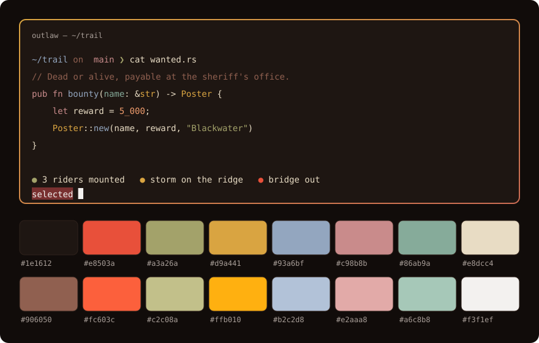

# Outlaw

A frontier colour scheme. Saddle leather and walnut underfoot, parchment text, rust and brass for emphasis, and faded denim, sage and verdigris for the cool notes.




## Omarchy

```bash
omarchy theme install https://github.com/cube-one-ber/omarchy-outlaw-theme
omarchy theme set outlaw
```

Omarchy generates every app's colours from [`colors.toml`](colors.toml). [`shell.toml`](shell.toml) replaces the generated shell styling with saloon menus: walnut cards with a tan edge, and a Sepia selection bar with ivory text and brass trim. Focused windows, popups and notifications share a brass-to-rust border.

Cycle the five wallpapers with `omarchy theme bg next`:

| Wallpaper | Grade |
| --- | --- |
| `0-frontier-print` | Albumen print: walnut → leather → tan → parchment, vignette, paper mottling and grain |
| `1-postcard` | Hand-tinted frontier postcard (default) |
| `2-dust-and-thunder` | Palette remap, luminance preserved |
| `3-sundown` | Softer palette remap |
| `4-iron-horse` | Full palette remap |

## Other apps

Standalone configs live in [`ports/`](ports). They don't need Omarchy.

| App | File | Install |
| --- | --- | --- |
| Ghostty | [`ports/ghostty/outlaw`](ports/ghostty/outlaw) | Copy to `~/.config/ghostty/themes/outlaw`, then set `theme = outlaw` |
| Alacritty | [`ports/alacritty/outlaw.toml`](ports/alacritty/outlaw.toml) | Add `import = ["/path/to/outlaw.toml"]` under `[general]` |
| Kitty | [`ports/kitty/outlaw.conf`](ports/kitty/outlaw.conf) | Add `include outlaw.conf` to `kitty.conf` |
| foot | [`ports/foot/outlaw.ini`](ports/foot/outlaw.ini) | Add `include=/path/to/outlaw.ini` to `foot.ini` |
| btop | [`ports/btop/outlaw.theme`](ports/btop/outlaw.theme) | Copy to `~/.config/btop/themes/`, then pick it under Options |
| Helix | [`ports/helix/outlaw.toml`](ports/helix/outlaw.toml) | Copy to `~/.config/helix/themes/`, then set `theme = "outlaw"` |
| Neovim | [`ports/neovim/outlaw.lua`](ports/neovim/outlaw.lua) | A [lazy.nvim](https://github.com/folke/lazy.nvim) spec for [aether.nvim](https://github.com/omacom/aether.nvim); drop it in `lua/plugins/` |
| VS Code | [`ports/vscode/outlaw-color-theme.json`](ports/vscode/outlaw-color-theme.json) | Contribute it as a `themes` entry in a local extension |

## Palette

Colours marked ★ come from the "Meditations in Color" swatches; the rest are frontier tones mixed to sit beside them.

| Colour | Hex | Role |
| --- | --- | --- |
| Walnut | `#1e1612` | Background |
| Worn leather | `#2e211b` | Raised surfaces |
| Parchment | `#e8dcc4` | Foreground |
| Ivory ★ | `#f3f1ef` | Bright foreground, cursor |
| Trail dust ★ | `#a89e98` | Dim text |
| Rust ★ | `#cc6c54` | Accent |
| Sepia ★ | `#783030` | Selection |
| Saddle leather ★ | `#906050` | Muted, comments |
| Brick | `#e8503a` | Red |
| Brass | `#d9a441` | Yellow |
| Pale geranium ★ | `#f09c6c` | Orange |
| Sagebrush | `#a3a26a` | Green |
| Verdigris | `#86ab9a` | Cyan |
| Faded denim | `#93a6bf` | Blue |
| Prairie rose | `#c98b8b` | Magenta |
| Light cadmium red ★ | `#fc603c` | Bright red |
| Gold ★ | `#ffb010` | Bright yellow |

`assets/palette.svg` is rendered from `colors.toml` by `python3 scripts/palette-svg.py`.

## Licence

MIT for the palette and configs. The wallpapers are derived from a SpaceX photograph and keep their own rights; see [NOTICE.md](NOTICE.md).
